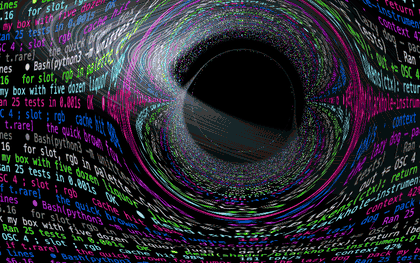
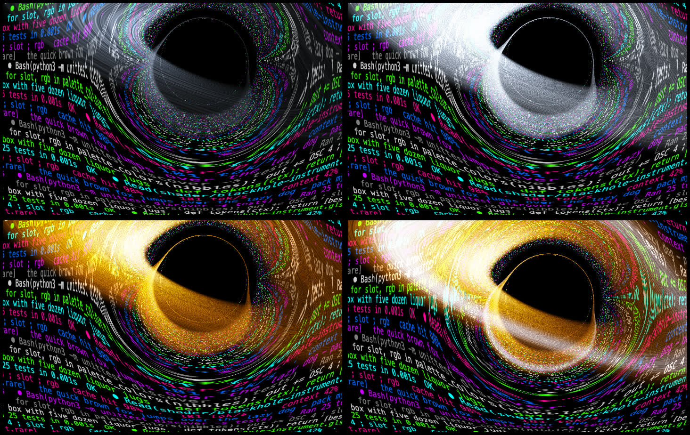
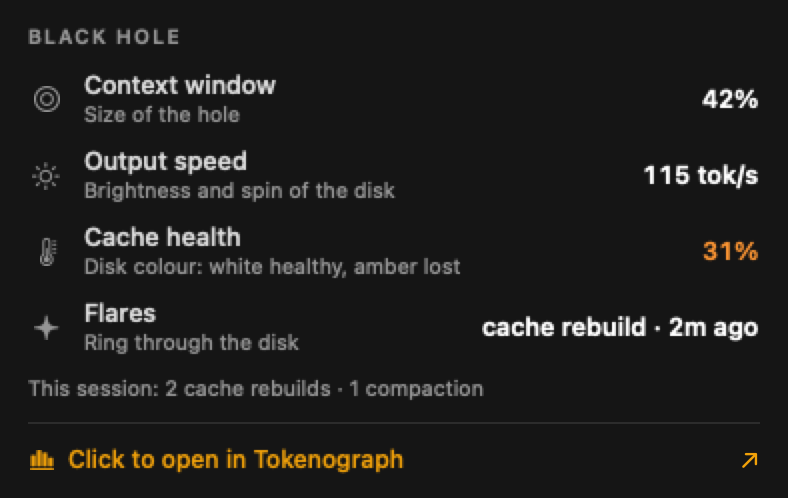

# ghostty-blackhole-instrument

The [Ghostty black hole](https://github.com/s0xDk/ghostty-blackhole), turned into an
instrument for Claude Code. Upstream grows a black hole in your terminal as the context
window fills. This fork keeps that and makes the accretion disk show what the session is
doing right now, using numbers from [Tokenograph](https://github.com/AI-et-al/Tokenograph).



| Read-out | What it measures | How it looks |
|---|---|---|
| **Fill** | Context window in use | The hole's size (unchanged from upstream) |
| **Burn** | Output tokens per second | Disk brightness and spin. Idle is a dim, slow ember. |
| **Heat** | Prompt-cache health | Disk colour: white-hot while the cache is hitting, amber after it is lost, warming back over the next few calls |
| **Flare** | A cache rebuild or a compaction | A blue-white shock ring through the disk: outward for a rebuild, inward plus a pale shell for a compaction |



Clockwise from top left: idle, working, a cache-rebuild flare, cache lost.

On macOS there is also a hover legend: point at the hole for the live numbers, click to open
the session in Tokenograph.



## Status

A working spike, built in a day and shared as is. It has run on exactly one Mac (macOS 27,
Ghostty 1.4.0, Claude Code 2.1). Nothing else has been tried: not Linux, not older Ghostty,
not split panes. No support is promised. If it breaks for you, the code is small and the
section on how it works should be enough for you or your agent to adapt it.

## Requirements

- **Ghostty 1.4.0 or later.** The instrument needs the `iPalette` shader input.
- **Claude Code**, running in Ghostty directly (tmux and zellij need OSC passthrough).
- **Python 3.8+.** The bridge uses only the standard library.
- **Tokenograph**, for burn, heat and flares. Without it the hole still tracks context fill.
- **macOS with the Swift toolchain**, only for the hover legend.

## Try it without installing anything

```sh
python3 preview/server.py        # then open http://127.0.0.1:8765/preview/
```

The preview runs the real shader in WebGL. Every slider and button goes through the real
bridge and applies the escape sequences it returns, so it exercises the bridge, the wire
format and the shader decode together.

## Install

```sh
git clone https://github.com/AI-et-al/ghostty-blackhole-instrument
cd ghostty-blackhole-instrument
pipx install git+https://github.com/AI-et-al/Tokenograph     # or: uv tool install ...
scripts/switch.py on             # then reload Ghostty's config: Cmd+Shift+, on macOS
```

Keep the checkout where you cloned it: the installer points Ghostty and Claude Code at the
files in place. If you move the folder, run `scripts/switch.py off` first and `on` after.

`switch.py on` looks at what you have and changes as little as it can:

- **Ghostty config:** adds the instrument as a `custom-shader`, or replaces the upstream
  `blackhole.glsl` line if you have one, and turns on `custom-shader-animation` if unset.
- **Claude Code hooks** (`~/.claude/settings.json`): `SessionStart`, `SessionEnd`,
  `UserPromptSubmit`, `Stop` and `Notification` hooks for the bridge. Upstream
  `claude-token.py` hooks are replaced, not doubled.
- **Status line:** if you have none, the bridge becomes it. If yours calls upstream
  `claude-token.py`, that call is swapped for the bridge. Any other status line is kept and
  wrapped: a small script feeds the bridge, then runs yours unchanged.
- **Tuner:** if you use the upstream tuner (`~/ghostty-blackhole`), its shader symlink is
  pointed at the instrument, so its sliders, including the new ones, edit the live shader.

Every file is backed up before its first change, and what was done is recorded in
`~/.config/blackhole-instrument/install.json`. To undo it:

```sh
scripts/switch.py off            # then reload Ghostty's config again
scripts/switch.py status         # what is wired where
```

Reload Ghostty straight after switching either way. The instrument shader understands the
upstream bridge, but the upstream shader does not understand this bridge and blinks the hole
off on every other update.

## Hover legend (macOS)

```sh
legend/build.sh                  # builds legend/BlackholeLegend.app
scripts/switch.py on             # installs it as a login item and starts it
```

Hold the pointer on the hole and a panel appears with each read-out's meaning and live
value for that tab's session. The panel stays where it appeared, so you can move onto it;
one click opens Tokenograph's full live panel for that session in your browser. The click
never takes keyboard focus from the terminal.

Ghostty does not give shaders the mouse position (`iMouse` is unsupported in 1.4.0), so the
legend is a separate background app. It only reads: the pointer position, window bounds,
Ghostty's scripting interface (which tty each window is showing) and the bridge's state
files in `~/.cache/blackhole-instrument/`. It never writes to a terminal.

- macOS asks once whether BlackholeLegend may control Ghostty; that is the which-tab-is-this
  lookup. If you decline, it uses the most recently active session. A rebuild changes the
  app's signature, so macOS asks again after one.
- The click runs `blackhole_instrument.py panel <session>`, which starts `tokenograph serve` on
  the first free port from 8787, one server per session. A second click reuses it, and it
  stops when the session ends. `blackhole_instrument.py panel --close-all` stops them all.
- After changing the helper's code: `legend/build.sh`, then `scripts/switch.py restart-legend`.

If the legend does not appear, draw what the helper believes:

```sh
touch ~/.cache/blackhole-instrument/legend-debug     # red ring = hole, orange = hover area, yellow = roam box
rm ~/.cache/blackhole-instrument/legend-debug
```

If the ring trails or sits off the hole, `~/.cache/blackhole-instrument/legend-config.json` takes
`{"time_offset": seconds, "top_inset": points, "tab_bar": points}`.

## Drive it by hand

In a Ghostty tab running the instrument shader:

```sh
./blackhole_instrument.py demo                                   # 50-second tour
./blackhole_instrument.py set --fill 0.4 --burn 0.9 --heat 0.2
./blackhole_instrument.py set --flare rebuild
./blackhole_instrument.py off
./blackhole_instrument.py show ~/.claude/projects/<project>/<session>.jsonl   # the derived numbers
```

## How it works

A Ghostty custom shader has no inputs of its own. Upstream smuggles the context fill in
through the **cursor colour** (OSC 12), which the shader reads as `iCurrentCursorColor`. That
channel has room for one byte.

Three things about Ghostty 1.4.0 make the rest possible. They took some probing to find and
may be useful for other shaders:

1. **The palette is a data channel.** Shaders receive the live 256-colour palette as
   `iPalette`, and OSC 4 changes to it arrive per surface, immediately, and byte-exact.
2. **There is no wall clock.** `iDate` is unsupported, so a stateless shader's only timer is
   `iTimeCursorChange`, which restarts whenever the cursor moves or changes colour.
3. **The shader's clock can be rebuilt from outside.** `iTime` counts from when the surface
   started, on the uptime clock. The kernel records each process's start on the same clock,
   so the oldest process on a tab's tty gives `iTime` closely enough to find a drifting hole.

The bridge writes the extra read-outs into **four palette entries** (58, 94, 100, 142). Only
the low nibble of each colour channel carries data and the high nibbles keep the xterm
default, so text drawn in those colours shifts by at most 15/255. An 8-bit check guards the
data; an untouched palette does not pass it, and then the shader renders exactly like
upstream.

```
cursor colour  R = F0 | check   G = B0 | fill_hi   B = tick << 4 | fill_lo
palette        n0 n1  burn target     n2 n3  burn previous
(12 nibbles)   n4 n5  heat target     n6 n7  heat previous
               n8     flare kind << 2 | magnitude      n9  flare age, half seconds
               n10 n11  xor of the five bytes above, xor B5
```

The bridge flips a spare bit in the cursor colour (`tick`) on every changed update. That
restarts `iTimeCursorChange`, and the shader glides each read-out from its previous value to
its target and runs the flare off the same clock.

Where the numbers come from (`derive_metrics` in `blackhole_instrument.py`, from `tokenograph json`):

- **Burn:** output tokens over decode time across the model calls of the last two minutes of
  session time; 200 tok/s reads as full. Zero when the turn is over.
- **Heat:** for each recent main-thread call, the share of the prompt that was *not* served
  from cache; the worst one counts, fading by 0.7 per later call. A new session starts cold.
- **Flare:** fires when Tokenograph's rebuild list or compaction count grows. The first look
  at a session never flares, so resuming does not replay old events.
- **Working or idle:** the last thing in the transcript (a tool-use call, an end of turn, an
  interrupt, a new prompt). The hooks only make the change show sooner.

One bridge run costs about 0.1 s including Tokenograph, and Tokenograph only runs when the
transcript has changed.

The hover legend finds the hole by re-running the shader's drift maths (`HoleTracker.swift`)
with the reconstructed `iTime`.

## Tuning

New tunables sit with the upstream ones at the top of `shader/blackhole-instrument.glsl`
(`BURN_*`, `HEAT_COLD_K`, `SIGNAL_GLIDE`, `FLARE_*`), in the format the upstream tuner edits.
Reload Ghostty's config after changing them.

The colour response is deliberately quiet: with a hot base disk temperature, the disk only
looks warm once cache health falls below about half. Lower `DISK_TEMP`, or raise
`HEAT_COLD_K`, if you want smaller cache misses to show.

## Known limits

- **A cursor move cuts a glide or flare short.** It restarts the same timer, and the shader
  cannot tell how long ago the bridge's update was, so it snaps to the target values and
  drops the flare rather than replaying it.
- **Spin is a blend.** Changing the disk's speed directly would teleport the streak pattern,
  so the shader crossfades a slow and a fast streak field.
- **One surface per window.** The legend assumes no split panes, and matches several
  Ghostty windows to their sessions by assuming Ghostty lists windows front to back.
- **Legend tracking at high context** (a large, fast-roaming hole) has not been checked.
- The four palette entries are reset when a session ends. If a session dies without its
  `SessionEnd` hook, `./blackhole_instrument.py off` in that tab resets them.

## Files

| Path | What |
|---|---|
| `blackhole_instrument.py` | The bridge: status line, hooks, manual commands, Tokenograph panel |
| `shader/blackhole-instrument.glsl` | Fork of upstream `blackhole.glsl`; additions are marked `Instrument` |
| `scripts/switch.py` | Install and uninstall, with backups |
| `preview/` | Browser preview and its small server |
| `legend/` | The hover legend helper (Swift) and `build.sh` |
| `tests/` | `python3 -m unittest discover -s tests` |

## Credits and licence

- The shader is a fork of [ghostty-blackhole](https://github.com/s0xDk/ghostty-blackhole) by
  s13k (MIT, `shader/LICENSE.ghostty-blackhole`), itself after Eric Bruneton's
  [black hole shader](https://ebruneton.github.io/black_hole_shader/). The geodesic tracing,
  the lensing and the cursor-colour channel are all upstream's work.
- The numbers come from [Tokenograph](https://github.com/AI-et-al/Tokenograph).

MIT. See `LICENSE`.
